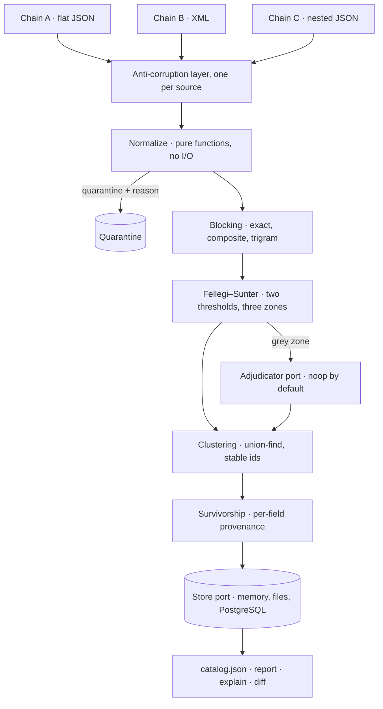

# Unified Drug Catalog

[](https://github.com/youredik/unified-drug-catalog/actions/workflows/ci.yml)
[](https://www.typescriptlang.org/)
[](https://nodejs.org/)
[](https://www.postgresql.org/)
[](LICENSE)

A service that takes product data from several suppliers in different formats,
maps it onto a single model and **merges duplicates** — so that for every field of
the resulting item you can see which source won it and under which rule.

```bash
pnpm install && pnpm ingest && pnpm export
```

```
chain-a   accepted 2 of 2
chain-b   accepted 2 of 2
chain-c   accepted 2 of 2
6 source records → 3 catalogue items
```

Six records from three chains produce **three** items. The product all three chains
describe collapses into one; a different dosage of the same brand and an
interchangeable alternative stay apart — merging those would be a costlier mistake
than merging nothing at all.

> Portfolio project. All data is fictional; code comments and CLI output are in
> Russian · [Русская версия](README.md)

---

## Requirements and how they're met

| Requirement | How |
| --- | --- |
| Read data from different sources | Transport and parser are declared in the source manifest; an anti-corruption layer translates foreign field names into the canon. Three formats: flat JSON, XML, nested JSON |
| Map onto a single model | `packages/domain` — a Published Language: branded types, a discriminated union by product kind, EDQM / UCUM / ISO 3166 vocabularies |
| Merge duplicates | A cascade: candidate blocking → Fellegi–Sunter with two thresholds → union-find clustering with stable identifiers |
| Keep every source on record | Provenance **per field**: source, survivorship rule, losing candidates, conflict flag. On PostgreSQL, also as a relation table |
| Emit the catalogue as JSON | `pnpm export` → a deterministic `catalog.json`: the same input yields a byte-identical file |
| A way to verify correctness | 149 unit and 7 integration tests, a labelled set with metrics, a golden snapshot, `pnpm report` and `pnpm explain` |

---

## Stack

Node 24 · TypeScript 5.9 with no build step — Node runs `.ts` directly, and
`erasableSyntaxOnly` forbids any syntax that would need compiling · Zod 4 ·
PostgreSQL 18 + `pg_trgm` · Drizzle · pg-boss · Vitest 4 + fast-check +
Testcontainers · dependency-cruiser · type-aware typescript-eslint ·
pnpm workspaces · Docker Compose.

---

## How it's built



```
domain  ←  normalize  ←  match  ←  connectors  ←  pipeline  ←  cli
   ↑ arrows only inward                            ↑
                                                   db
```

The dependency rule is a CI gate, not an agreement. What matters isn't the layering
but the **ban on I/O in the core**: `normalize` and `match` physically cannot reach
the filesystem, the network or the database. Hence property tests without a mock.

It extends in three places, each a port: a **source** (manifest + ACL + a green
conformance run), a **store** (memory, files, PostgreSQL) and the **grey-zone
adjudicator**.

---

## Key decisions

- **An invalid identifier is demoted, not discarded.** The barcodes fail MOD-10;
  "validate and drop" would delete the whole dataset. Valid means *assert identity*,
  invalid means *only compare*: it gathers candidates into a block, and the full
  field comparison decides.
- **Quality flags reach the maths, not the log.** GTIN equality has two levels:
  `equal_and_valid` (u = 0.00001) and `equal_but_invalid` (u = 0.002). A failed
  checksum weakens the evidence — an adjustment to the likelihood ratio, not a
  separate heuristic.
- **Three zones, not two.** Two thresholds give match, non-match and an undecided
  zone between them. Where the evidence runs out, the system stays silent and hands
  the pair to a human instead of guessing.
- **Provenance and survivorship are per field, not per record.** A source can be the
  most accurate on one field and wrong on the next, so a global source ranking is
  wrong by construction. And only **verifiable** specificity wins — a refinement no
  vocabulary confirms is recorded as a conflict.
- **Ambiguity is never collapsed.** Prescription status is tri-state; `unknown`
  never becomes `otc`, because dispensing decisions ride on it. Date formats are
  declared per source, never guessed — `03.04.2023` is unresolvable.
- **Determinism is an invariant.** Time and run id arrive as parameters from above,
  clusters sort by their smallest member. Without that, the golden snapshot and
  `catalog:diff` verify nothing. A run that fails the quality gates never finishes —
  the previous, intact catalogue stays current.
- **Input is treated as hostile.** XML entities and DTDs are off, size and depth
  limits are enforced, and the transport resolves the address once and pins the
  verified IP for the connection — a host allowlist is defeated by DNS rebinding.

---

## Verification

```bash
pnpm test               # 149 unit tests
pnpm test:integration   # 7 integration tests on a live PostgreSQL (needs Docker)
make check              # what CI runs, in the same order
```

| Layer | What it proves |
| --- | --- |
| Table-driven normalizer tests | the edge cases of every rule |
| Labelled set, 12 pairs | precision / recall / F1 and the price of each threshold; includes hard negatives — a different brand under the same INN, a different pack size, one identifier on two products |
| Property tests (fast-check) | the result is independent of source order, no record is lost or assigned twice, different dosages never merge |
| Golden snapshot | byte-level stability of the export |
| Connector conformance suite | 9 checks shared by every source |
| Security tests | XXE, billion laughs, zip bombs, private addresses, allowlist bypass |
| Testcontainers | the catalogue doesn't depend on the chosen store |

**The gates are proven to bite** — the dependency rule and the golden snapshot were
broken on purpose to confirm they fail. CI runs everything in four parallel jobs;
actions are pinned by commit SHA, not by tag.

`pnpm explain` breaks down any item's decision:

```
  chain-a:A-1001  ↔  chain-b:NET2-88
    gtin           equal_but_invalid    +8.81
    brandKey       exact                +8.09
    strength       exact                +3.55
    doseForm       exact_basic          +1.90
    pack           exact                +2.91
    organization   exact                +4.78
    TOTAL                               28.05   probability 100.00%
```

The threshold is 14. The same brand at 200 mg against 400 mg scores **−1.13**:
a matching brand and manufacturer don't outweigh the disagreement on dosage and pack.

---

## Why there's no language model in the main path

It practically asks for one: the Fellegi–Sunter grey zone is exactly where an LLM
adjudicator normally goes. The measurement harness was written **before** the
question was settled, and it runs the labelled set twice — with the model and
without:

```
                   precision   recall      F1    undecided
  baseline           100.0%   100.0%  100.0%        4
```

The rules don't get it wrong. A model would only resolve four disputed pairs out of
twelve — the same four a human already reviews. Paying for that in money, latency,
non-determinism and prompt-injection surface is a bad trade, so `NoopAdjudicator` is
the default.

What stays: the adjudicator port, the hard-case set, the threshold sweep and the
contribution harness. The Opus 5 adapter is written and enabled with
`--adjudicator=claude`; it has no tools and no side effects, so a successful
injection through a product name costs at most one wrong pair, visible in the audit
trail. The reversal condition is stated: when the grey zone stops fitting into
manual review, or when more sources collapse the 0.70-in-log₂ margin.

---

## How this was built with AI

One rule: **nothing enters the code or the docs from a model's memory.** Domain
claims go to primary sources, versions to the registry, SDK signatures to the
`.d.ts` in `node_modules`. That inverted a conclusion twice: a primary source
contradicted what the secondary ones implied, and the survivorship rule came out
stricter; and a plausible-looking matching library turned out to be a three-month-old
assembly with self-reported benchmarks.

The same standard applied to tests. One asserted "zero false positives" because that
was the desired answer; the run produced three and reproduced the known tendency of
rule-based linkage to over-merge. It was rewritten to record the baseline honestly
and the thresholds were raised from the sweep. And tools look for classes of bugs,
not instances: type-aware linting found fourteen places where an untrusted value was
coerced with `String(x)` — on an object that yields `[object Object]`, a string that
looks like data and travels on into the parser.

---

## Deliberate limits

- **Vocabularies** — EDQM, ATC and INN ship as a subset covering the demo data,
  behind a lookup seam built for replacement.
- **LSH / MinHash blocking** isn't needed: the three-layer blocker is adequate well
  past this scale; similarity hashing belongs at tens of millions of records.
- **Per-source trust weights** are left neutral — lowering them over one observed
  mistake means fitting the model to six records.
- **TypeScript 7** was tried by installing it: the project compiles and typechecks,
  but `typescript-eslint` doesn't support it, and the move would cost type-aware
  linting.
- **OpenTelemetry** is absent: the seams are there, but there's nothing here to
  verify it against, and unverified code doesn't belong in the repository.

---

## Layout

```
packages/
  domain/       Published Language: canonical model, branded types, vocabularies.
                Zero project dependencies — enforced by a gate
  normalize/    Pure functions, errors as values. No I/O — enforced by a gate
  match/        Blocking, Fellegi–Sunter, clustering, survivorship
  connectors/   SPI, per-source ACL, hardened parsers and transports, conformance
  pipeline/     Ingest, quality gates, the store port and its three adapters,
                export, report, explain, diff, pg-boss worker
  db/           bronze / silver / gold / audit schemas, migrations from schema
  adjudicator/  LLM adjudicator adapter. Written, measured, switched off
apps/
  cli/          ingest · export · report · explain · diff · worker
data/sources/   The three demo feeds
fixtures/       Golden snapshot, recorded adjudicator verdicts
```

---

MIT — see [LICENSE](LICENSE).
