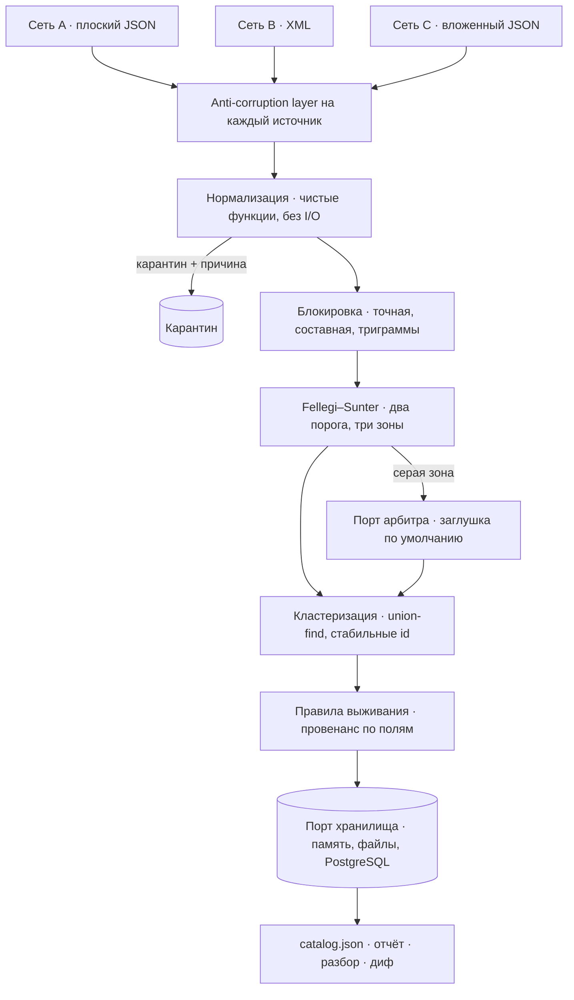

# Единый каталог лекарств

[](https://github.com/youredik/unified-drug-catalog/actions/workflows/ci.yml)
[](https://www.typescriptlang.org/)
[](https://nodejs.org/)
[](https://www.postgresql.org/)
[](LICENSE)

Сервис принимает данные о товарах от нескольких поставщиков в разных форматах,
приводит к единой модели и **объединяет дубликаты** — так, чтобы у каждого поля
итоговой позиции было видно, какой источник его выиграл и по какому правилу.

```bash
pnpm install && pnpm ingest && pnpm export
```

```
chain-a   принято 2 из 2
chain-b   принято 2 из 2
chain-c   принято 2 из 2
записей источников 6 → позиций каталога 3
```

Шесть записей трёх сетей дают **три** позиции. Товар, который описали все три
сети, схлопывается в одну; другая дозировка того же бренда и взаимозаменяемый
аналог остаются отдельными — склеить их было бы ошибкой дороже, чем не склеить
ничего.

> Портфолио-проект, данные вымышленные · [English](README.en.md)

---

## Что требуется и как решено

| Требование | Как закрыто |
| --- | --- |
| Читать данные из разных источников | Транспорт и парсер объявлены в манифесте источника; anti-corruption layer переводит чужие имена полей в канон. Три формата: плоский JSON, XML, вложенный JSON |
| Привести к единой модели | `packages/domain` — Published Language: брендированные типы, размеченное объединение по виду товара, словари EDQM / UCUM / ISO 3166 |
| Объединить дубликаты | Каскад: блокировка кандидатов → Fellegi–Sunter с двумя порогами → кластеризация union-find со стабильными идентификаторами |
| Сохранить сведения обо всех источниках | Провенанс **на уровне полей**: источник, правило выживания, проигравшие кандидаты, признак конфликта. В PostgreSQL — ещё и отдельной таблицей связей |
| Выдать каталог в JSON | `pnpm export` → детерминированный `catalog.json`: одни данные дают побайтово тот же файл |
| Способ проверки корректности | 149 юнит-тестов и 7 интеграционных, размеченный набор с метриками, golden-снапшот, `pnpm report` и `pnpm explain` |

---

## Стек

Node 24 · TypeScript 5.9 без сборки — Node исполняет `.ts` напрямую, а
`erasableSyntaxOnly` не даёт написать синтаксис, который потребовал бы
компиляции · Zod 4 · PostgreSQL 18 + `pg_trgm` · Drizzle · pg-boss ·
Vitest 4 + fast-check + Testcontainers · dependency-cruiser · typescript-eslint
с проверкой типов · pnpm-воркспейс · Docker Compose.

---

## Как устроено



```
domain  ←  normalize  ←  match  ←  connectors  ←  pipeline  ←  cli
   ↑ стрелки только внутрь                          ↑
                                                    db
```

Правило зависимостей — гейт в CI, а не договорённость. Ценно не расположение
слоёв, а **запрет ввода-вывода в ядре**: `normalize` и `match` физически не могут
дотянуться до файлов, сети или базы. Отсюда property-тесты без единого мока.

Расширяется в трёх местах, и каждое — порт: **источник** (манифест + ACL +
зелёный conformance-набор), **хранилище** (память, файлы, PostgreSQL) и **арбитр
серой зоны**.

---

## Ключевые решения

- **Невалидный идентификатор не отбрасывается, а понижается в роли.** Штрихкоды
  в данных не проходят MOD-10; «проверить и отбросить» удалило бы весь датасет.
  Валидный — основание утверждать тождество, невалидный — только основание
  сравнить: он собирает кандидатов в блок, а решает полное сравнение полей.
- **Флаг качества входит в математику, а не в лог.** У совпадения идентификатора
  два уровня: `equal_and_valid` (u = 0.00001) и `equal_but_invalid` (u = 0.002).
  Несошедшаяся контрольная сумма ослабляет свидетельство — это корректировка
  отношения вероятностей, а не отдельная эвристика.
- **Три зоны вместо двух.** Два порога дают «совпало», «разные» и зону
  неопределённости между ними. Где данных не хватает, система молчит и отдаёт
  пару человеку, а не угадывает.
- **Провенанс и выживание — по полям, а не по записи.** Источник бывает самым
  точным в одном поле и неверным в соседнем: глобальный рейтинг источников
  неверен по построению. И побеждает только **проверяемая** специфичность —
  уточнение без подтверждения справочником записывается конфликтом.
- **Неопределённость не схлопывается.** Рецептурность tri-state, `unknown`
  никогда не станет `otc`: на этом принимают решения об отпуске. Формат даты
  объявлен в манифесте, а не угадан — `03.04.2023` неразрешима.
- **Детерминированность — инвариант.** Время и идентификатор прогона приходят
  параметрами сверху, кластеры сортируются по наименьшему участнику. Без этого
  golden-снапшот и `catalog:diff` ничего не проверяют. Прогон, не прошедший гейты
  качества, не завершается — последним остаётся прошлый, целый каталог.
- **Приём считает вход враждебным.** Сущности и DTD у XML выключены, стоят лимиты
  размера и глубины, транспорт резолвит адрес один раз и закрепляет проверенный
  IP на соединение — allowlist по хосту обходится подменой DNS.

---

## Проверка

```bash
pnpm test          # 149 юнит-тестов
pnpm test:integration   # 7 интеграционных на живом PostgreSQL (нужен Docker)
make check         # то же, что гоняет CI, в том же порядке
```

| Слой | Что доказывает |
| --- | --- |
| Табличные тесты нормализаторов | граничные случаи каждого правила |
| Размеченный набор, 12 пар | precision / recall / F1 и цена каждого порога; есть трудные отрицательные — другой бренд при том же МНН, другая упаковка, один идентификатор на два товара |
| Property-тесты (fast-check) | результат не зависит от порядка источников, ни одна запись не теряется и не попадает в две позиции, разная дозировка не склеивается никогда |
| Golden-снапшот | побайтовая стабильность выгрузки |
| Conformance-набор коннекторов | 9 проверок, общих для всех источников |
| Тесты безопасности | XXE, billion laughs, zip-бомба, приватные адреса, обход allowlist |
| Testcontainers | каталог не зависит от выбора хранилища |

**Гейты проверены намеренным нарушением** — правило зависимостей и golden-снапшот
сломаны нарочно, чтобы убедиться, что они падают. CI гоняет всё четырьмя
параллельными задачами, внешние действия закреплены по SHA коммита, а не по тегу.

Разбор решения по любой позиции — `pnpm explain`:

```
  chain-a:A-1001  ↔  chain-b:NET2-88
    gtin           equal_but_invalid    +8.81
    brandKey       exact                +8.09
    strength       exact                +3.55
    doseForm       exact_basic          +1.90
    pack           exact                +2.91
    organization   exact                +4.78
    ИТОГО                               28.05   вероятность 100.00%
```

Порог — 14. Те же 200 мг против 400 мг того же бренда дают **−1.13**: совпадающие
бренд и производитель не перевешивают расхождения по дозировке и упаковке.

---

## Почему языковой модели нет в основном пути

Она здесь напрашивается: серая зона Fellegi–Sunter — ровно то место, где обычно
ставят LLM-арбитра. Инструмент замера написан **до** того, как решался вопрос
о включении, и гоняет размеченный набор дважды — с моделью и без:

```
                   precision   recall      F1    неопределённых
  базовая линия      100.0%   100.0%  100.0%        4
```

Правила не ошибаются. Модель разобрала бы только четыре спорные пары
из двенадцати — те самые, что и так уходят человеку. Платить за это деньгами,
задержкой, недетерминированностью и поверхностью для инъекции промпта — плохая
сделка, поэтому `NoopAdjudicator` стоит по умолчанию.

Остаются порт арбитра, набор трудных случаев, свип по порогам и функция замера.
Адаптер на Opus 5 написан и включается флагом `--adjudicator=claude`; у него нет
инструментов и побочных эффектов, поэтому удавшаяся инъекция через название товара
стоит максимум одной неверной пары, видимой в аудите. Критерий пересмотра назван:
когда серая зона перестанет помещаться в ручной разбор или когда рост числа
источников схлопнет зазор в 0.70 log₂ между классами.

---

## Как это делалось в паре с ИИ

Правило было одно: **ничто не попадает в код и в документацию из памяти модели.**
Предметные утверждения — к первоисточнику, версии — в реестр, сигнатуры SDK —
в `.d.ts` из `node_modules`. Дважды это перевернуло вывод: первоисточник опроверг
то, что следовало из вторичных, и правило выживания стало строже; правдоподобно
выглядевшая библиотека матчинга оказалась трёхмесячной поделкой с самозаявленными
бенчмарками.

Тот же стандарт — к тестам. Один утверждал «ложноположительных ноль», потому что
это был желаемый ответ; прогон дал три и воспроизвёл известное свойство правил
переобъединять. Переписан на честную фиксацию базовой линии, пороги подняты
по свипу. А инструменты ищут классы ошибок, а не случаи: линтер с проверкой типов
нашёл четырнадцать мест, где недоверенное значение приводилось к тексту через
`String(x)` — на объекте это даёт `[object Object]`, строку, которая выглядит как
данные и едет дальше в парсер.

---

## Осознанные ограничения

- **Справочники** EDQM, АТХ и МНН лежат подмножеством под демонстрационные данные,
  за интерфейсом поиска, рассчитанным на замену.
- **LSH / MinHash в блокировке** не нужен: трёхслойной хватает далеко за пределами
  этого масштаба, хеширование по сходству — за десятками миллионов записей.
- **Веса доверия к источникам** оставлены нейтральными: занижать их по одной
  замеченной ошибке значит подгонять модель под шесть записей.
- **TypeScript 7** проверен установкой — проект собирается и типы проходят, но
  `typescript-eslint` его не поддерживает, и переход стоил бы линтера с проверкой
  типов.
- **OpenTelemetry** не подключён: швы для него есть, но проверить его здесь не на
  чем, а непроверенному коду в репозитории не место.

---

## Структура

```
packages/
  domain/       Published Language: канон-модель, брендированные типы, словари.
                Ноль зависимостей от проекта — проверяется гейтом
  normalize/    Чистые функции, ошибки как значения. Без I/O — проверяется гейтом
  match/        Блокировка, Fellegi–Sunter, кластеризация, правила выживания
  connectors/   SPI, ACL на источник, безопасные парсеры и транспорты, conformance
  pipeline/     Приём, гейты качества, порт хранилища и три адаптера, выгрузка,
                отчёт, разбор, диф, воркер pg-boss
  db/           Схемы bronze / silver / gold / audit, миграции из схемы
  adjudicator/  Адаптер арбитра на языковой модели. Написан, замерен, выключен
apps/
  cli/          ingest · export · report · explain · diff · worker
data/sources/   Три демонстрационные выгрузки
fixtures/       Golden-снапшот, записанные вердикты арбитра
```

---

MIT — см. [LICENSE](LICENSE).
